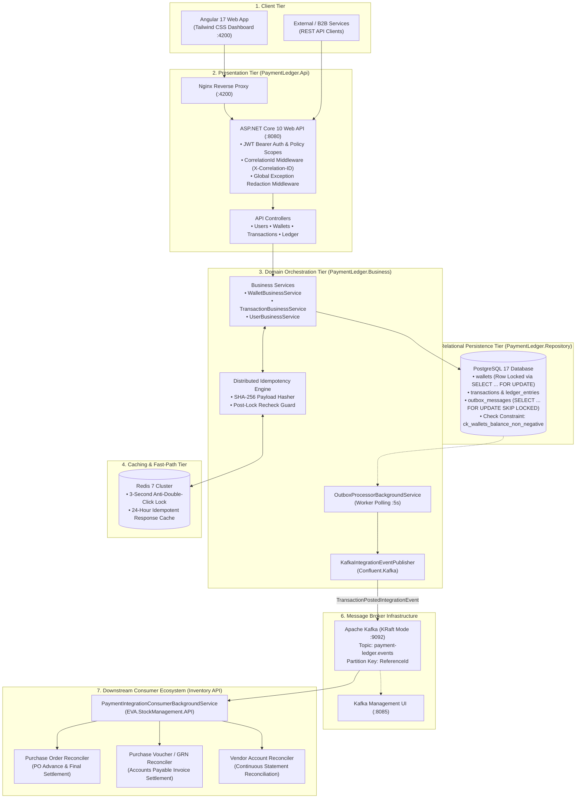
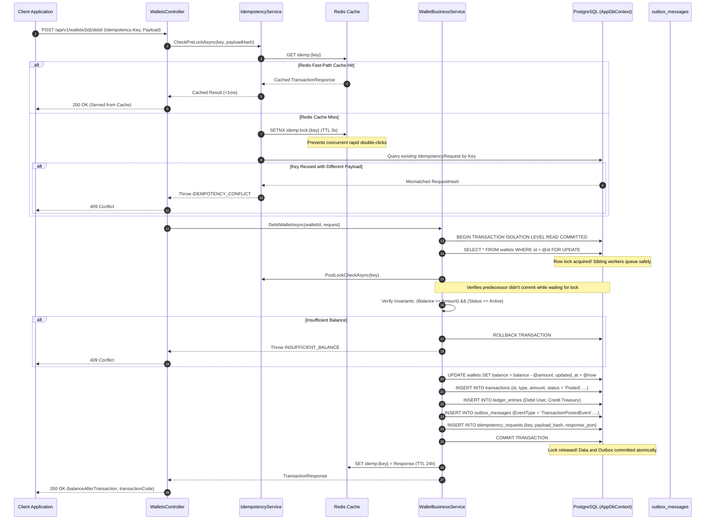
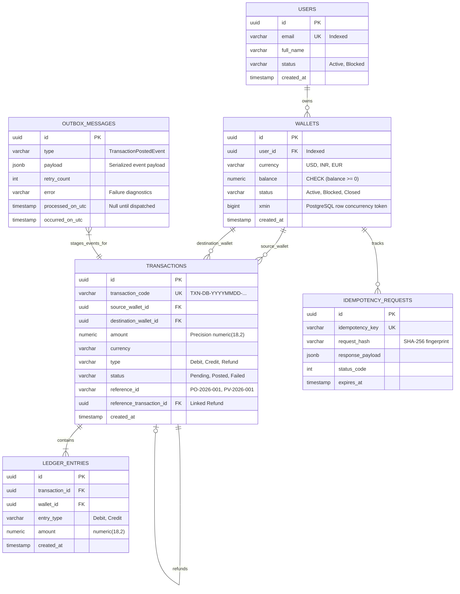
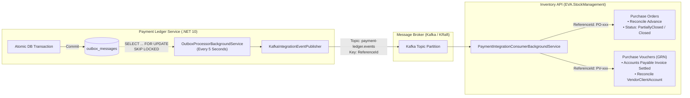

# 🏦 Payment Ledger Service

[](https://dotnet.microsoft.com/)
[](https://learn.microsoft.com/en-us/dotnet/csharp/)
[](https://www.postgresql.org/)
[](https://redis.io/)
[](https://kafka.apache.org/)
[](https://angular.io/)
[](https://tailwindcss.com/)
[](tests/)
[](tests/PaymentLedger.ArchitectureTests/)

A production-grade, highly concurrent digital wallet and double-entry financial ledger service designed for zero financial discrepancies, millisecond idempotency resolution, and guaranteed event streaming across distributed microservices.

---

## 📑 Table of Contents

- [1. Executive Architecture Summary](#1-executive-architecture-summary)
- [2. System Architecture (HLD & LLD)](#2-system-architecture-hld--lld)
  - [High-Level Design (HLD)](#high-level-design-hld)
  - [Low-Level Design (LLD): Financial Mutation Pipeline](#low-level-design-lld-financial-mutation-pipeline)
  - [Low-Level Design (LLD): Domain Entity & Data Model](#low-level-design-lld-domain-entity--data-model)
- [3. Core Financial & Concurrency Invariants](#3-core-financial--concurrency-invariants)
- [4. Transactional Outbox & Event-Driven Ecosystem](#4-transactional-outbox--event-driven-ecosystem)
- [5. Solution Structure & Layer Boundaries](#5-solution-structure--layer-boundaries)
- [6. Quick Start & Deployment](#6-quick-start--deployment)
- [7. API Reference Matrix](#7-api-reference-matrix)
- [8. Quality Gates & Test Verification](#8-quality-gates--test-verification)
- [9. Error Catalog & Resilience](#9-error-catalog--resilience)

---

## 1. Executive Architecture Summary

| Capability | Implementation Mechanism | Production Guarantee |
|---|---|---|
| **Bookkeeping Core** | Pure Double-Entry Bookkeeping | $\sum \text{Debits} \equiv \sum \text{Credits} \equiv \text{Txn Amount}$. Every mutation links to immutable ledger pairs. |
| **Concurrency Guard** | PostgreSQL `SELECT ... FOR UPDATE` | Strict serialization of wallet mutations. Zero negative balances under extreme concurrency. |
| **Idempotency Engine** | Hybrid Redis (`SETNX`) + PostgreSQL Fingerprinting | Fast-path `<1ms` cached responses; SHA-256 payload tampering rejection (`HTTP 409`). |
| **Dual-Write Safety** | Transactional Outbox Pattern | Domain events staged atomically within the mutation transaction. No phantom publishes. |
| **Event Dispatcher** | Polling Worker + `SKIP LOCKED` | Parallel worker nodes consume batches without lock contention or cross-worker blocking. |
| **Message Broker** | Apache Kafka (KRaft mode) | Partition-ordered delivery keyed by `ReferenceId` for downstream inventory settlement. |
| **Downstream Consumers**| Inventory API (`EVA.StockManagement`) | Automated Purchase Order (`PO`) closing and Goods Received Note (`GRN`) accounts payable matching. |
| **Architectural Rigor**| Automated NetArchTest Rules | 3-tier boundaries strictly enforced at compile/test time. Zero repository leakage to API. |

---

## 2. System Architecture (HLD & LLD)

### High-Level Design (HLD)

The macro-system topology spans user-facing clients, an API presentation gateway, transactional core domain, distributed caching, PostgreSQL relational storage, and Kafka-driven integration with downstream ERP microservices:



---

### Low-Level Design (LLD): Financial Mutation Pipeline

The sequence below illustrates the end-to-end lifecycle of a balance mutation (`Debit`), demonstrating the multi-stage concurrency controls, row locking, double-entry ledger insertion, outbox staging, and cache updates:



---

### Low-Level Design (LLD): Domain Entity & Data Model

The database schema strictly adheres to double-entry financial accounting. Check constraints enforce non-negative balances at the storage engine level:



---

## 3. Core Financial & Concurrency Invariants

### 1. Mathematical Double-Entry Balancing
For every financial mutation, balanced debit and credit entries are posted simultaneously:
$$\sum \text{Debits} \equiv \sum \text{Credits} \equiv \text{Transaction.Amount}$$
* **Credit Flow**: Treasury Wallet $\rightarrow$ Debit; User Wallet $\rightarrow$ Credit.
* **Debit Flow**: User Wallet $\rightarrow$ Debit; Treasury Wallet $\rightarrow$ Credit.
* **Refund Flow**: Treasury Wallet $\rightarrow$ Debit; User Wallet $\rightarrow$ Credit (traceably linked via `reference_transaction_id`).

### 2. Pessimistic Row-Level Locking (`SELECT ... FOR UPDATE`)
All balance-altering mutations acquire an exclusive row lock on the target wallet within an active database transaction. Sibling concurrent requests are serialized deterministically, eliminating lost updates and race conditions.

### 3. Engine-Level Zero-Negative Balance Guard
In addition to domain-layer balance checks, the storage engine enforces a PostgreSQL check constraint:
```sql
CONSTRAINT ck_wallets_balance_non_negative CHECK (balance >= 0)
```
Even if application-level validation were bypassed, the database kernel strictly rejects any transaction that would produce a negative balance.

### 4. Distributed Multi-Tier Idempotency
* **Fast-Path (Redis)**: Keyed transactions are checked against Redis with sub-millisecond retrieval.
* **Fingerprint Integrity**: Computes a cryptographic SHA-256 hash across `Amount`, `Currency`, `Description`, and `Metadata`. Key reuse with altered parameters throws `409 Conflict` (`IDEMPOTENCY_CONFLICT`).
* **Anti-Double-Click Guard**: Unkeyed requests trigger a 3-second memory/Redis throttle, rejecting accidental duplicate clicks with `429 Too Many Requests`.
* **Post-Lock Idempotency Verification**: Re-checks the idempotency record immediately after acquiring the database lock to intercept duplicate requests that queued while the first request was committing.

---

## 4. Transactional Outbox & Event-Driven Ecosystem

To guarantee event delivery without distributed 2PC transactions or dual-write inconsistencies, the system employs the **Transactional Outbox Pattern**:



* **Lock-Free Parallel Polling**: Multiple worker nodes query `outbox_messages` using `SELECT ... FOR UPDATE SKIP LOCKED`. Workers claim mutually exclusive batches without deadlocks or idle waiting.
* **Partition Affinity**: Outbox messages are published to Kafka keyed by `ReferenceId` (e.g. `PO-2026-001`, `PV-2026-001`). This guarantees total ordering across all financial state updates for any single voucher or order.
* **At-Least-Once Delivery**: Messages are marked as `processed_on_utc` only after the broker acknowledges persistent receipt. Broker unavailability increments `retry_count` and records error traces for automated retry backoff.

---

## 5. Solution Structure & Layer Boundaries

The codebase enforces a streamlined 3-tier architecture with zero MediatR indirection:

```
PaymentLedgerService/
├── src/
│   ├── PaymentLedger.Api/              # Presentation: Controllers, Middleware, Hosted Services
│   │   ├── Controllers/               # UsersController, WalletsController, TransactionsController, LedgerController
│   │   ├── BackgroundServices/        # OutboxProcessorBackgroundService (SKIP LOCKED poller)
│   │   ├── Middleware/                # CorrelationIdMiddleware, GlobalExceptionHandlerMiddleware
│   │   └── Program.cs                 # Bootstrap, Serilog configuration, pipeline wiring
│   │
│   ├── PaymentLedger.Business/         # Core Domain Logic & Financial Orchestration
│   │   ├── Services/                  # WalletBusinessService, TransactionBusinessService, UserBusinessService
│   │   ├── Events/                    # KafkaIntegrationEventPublisher, LoggingIntegrationEventPublisher, DomainEvents
│   │   ├── Models/                    # Consolidated DTOs (WalletModels.cs, TransactionModels.cs, UserModels.cs)
│   │   └── Common/                    # IdempotencyService, SystemDateTimeProvider
│   │
│   ├── PaymentLedger.Repository/       # Persistence & Database Access
│   │   ├── Entities/                  # Wallet, Transaction, LedgerEntry, OutboxMessage, IdempotencyRequest, User
│   │   ├── Persistence/               # AppDbContext, EntityConfigurations (Fluent API), Migrations
│   │   ├── Repositories/              # WalletRepository (Row Locking), OutboxRepository (SKIP LOCKED), LedgerRepository
│   │   └── Seeding/                   # TreasuryWalletSeeder (Multi-currency system accounts)
│   │
│   └── PaymentLedger.Shared/           # Cross-Cutting Contracts (Independent of all solution layers)
│       ├── Events/                    # TransactionPostedIntegrationEvent
│       ├── Options/                   # KafkaOptions, OutboxOptions, JwtOptions
│       └── Responses/                 # ApiResponse<T>, ErrorResponse, PagedResponse<T>
│
├── tests/
│   ├── PaymentLedger.UnitTests/         # 216 tests: Invariants, business orchestration, idempotency, Kafka publisher
│   ├── PaymentLedger.ArchitectureTests/ # 7 tests: NetArchTest enforcing strict layer boundaries
│   └── PaymentLedger.IntegrationTests/  # 9 tests: Real PostgreSQL Testcontainers concurrency tests
│
└── PaymentLedger.UI/                   # Angular 17.3 + Tailwind CSS Dashboard SPA
```

> **Architectural Boundary Rules**:
> 1. `PaymentLedger.Api` references `Business` and `Shared`. It **never** references `Repository` (verified via NetArchTest).
> 2. `PaymentLedger.Business` references `Repository` and `Shared`. It **never** references `Api`.
> 3. `PaymentLedger.Repository` references `Shared`. It **never** references `Business` or `Api`.
> 4. `PaymentLedger.Shared` is completely decoupled and references no solution projects.

---

## 6. Quick Start & Deployment

### Option A: Docker Compose (Full Stack - Recommended)

Launches PostgreSQL 17, Redis 7, Apache Kafka (KRaft), Kafka UI, Web API, and the Angular Dashboard:

```powershell
# Build and launch all services in detached mode
docker compose up -d --build

# Inspect real-time service logs
docker compose logs -f

# Teardown all containers
docker compose down
```

| Service | Port | Endpoint URL | Description |
|---|---|---|---|
| **Angular UI** | `4200` | `http://localhost:4200` | Web dashboard & real-time burst concurrency tester |
| **Web API Gateway** | `8080` | `http://localhost:8080` | ASP.NET Core REST API |
| **Swagger UI** | `8080` | `http://localhost:8080/swagger` | Interactive OpenAPI documentation |
| **Kafka Web UI** | `8085` | `http://localhost:8085` | Kafka topic inspector & consumer group monitor |
| **Kafka Broker** | `9092` | `localhost:9092` | External PLAINTEXT host listener |
| **PostgreSQL** | `5432` | `localhost:5432` | Primary ledger database |
| **Redis** | `6379` | `localhost:6379` | Fast-path idempotency cache & distributed locks |
| **RabbitMQ (Optional)** | `15672` | `http://localhost:15672` | Active when started with `--profile rabbitmq` |

### Option B: Local .NET CLI Backend Run

```powershell
# Run backend against a local PostgreSQL instance
dotnet run --project src/PaymentLedger.Api
```

---

## 7. API Reference Matrix

All mutating endpoints enforce mandatory or optional `Idempotency-Key` headers and correlation tracking via `X-Correlation-ID`.

| Category | Method | Endpoint | Description | Idempotency Supported |
|---|---|---|---|:---:|
| **Auth** | `POST` | `/api/v1/auth/token` | Issues signed HMAC-SHA256 JWT tokens with custom scopes | N/A |
| **Users** | `POST` | `/api/v1/users` | Creates a new user identity with unique email validation | No |
| | `GET` | `/api/v1/users` | Paginated user search query with filtering | No |
| | `GET` | `/api/v1/users/{id}` | Retrieves user profile metadata | No |
| **Wallets** | `POST` | `/api/v1/wallets` | Opens a currency-specific wallet for an active user | Yes |
| | `GET` | `/api/v1/wallets/{id}` | Queries wallet balance and active lifecycle state | No |
| | `PATCH` | `/api/v1/wallets/{id}/block` | Blocks wallet from accepting financial mutations | Yes |
| | `PATCH` | `/api/v1/wallets/{id}/close` | Closes empty wallet (enforces balance == 0 invariant) | Yes |
| **Mutations** | `POST` | `/api/v1/wallets/{id}/credit` | Credits funds from Treasury with balanced double entries | **Yes** |
| | `POST` | `/api/v1/wallets/{id}/debit` | Debits wallet with `SELECT ... FOR UPDATE` row locking | **Yes** |
| | `GET` | `/api/v1/wallets/{id}/transactions` | Paginated transaction ledger history | No |
| **Refunds** | `POST` | `/api/v1/transactions/{id}/refund`| Processes full/partial refund linked to original debit | **Yes** |
| **Audit** | `GET` | `/api/v1/ledger/verify` | System-wide mathematical reconciliation audit | No |
| | `GET` | `/api/v1/wallets/{id}/verify` | Cryptographic balance vs ledger entry verification | No |

### Sample Mutation Request

```bash
curl -X POST "http://localhost:8080/api/v1/wallets/6b72a6c8-e047-466d-888e-670dc5fa3cf8/debit" \
  -H "Content-Type: application/json" \
  -H "Idempotency-Key: PO-2026-001-PAYMENT" \
  -H "Authorization: Bearer <TOKEN>" \
  -d '{
    "amount": 1500.00,
    "currency": "USD",
    "referenceId": "PO-2026-001",
    "description": "Advance payment for procurement order"
  }'
```

---

## 8. Quality Gates & Test Verification

The solution enforces a zero-tolerance policy for test failures and architecture violations. 100% of tests execute automatically via the .NET CLI:

```powershell
# Run the complete test suite across all 3 test projects
dotnet test PaymentLedgerService.sln
```

```
Total Tests: 232  |  Passed: 232  |  Failed: 0  |  Skipped: 0
```

| Test Project | Test Count | Scope & Coverage | Execution Time |
|---|:---:|---|:---:|
| **`PaymentLedger.UnitTests`** | **216** | Double-entry invariants, pessimistic locking simulation, Redis fail-safe fallback, SHA-256 idempotency fingerprinting, Kafka integration event publisher, refund limits, outbox dispatcher | `~450ms` |
| **`PaymentLedger.ArchitectureTests`** | **7** | NetArchTest boundary checks: layer independence, zero repository access from controllers, middleware isolation | `~300ms` |
| **`PaymentLedger.IntegrationTests`** | **9** | Real PostgreSQL Testcontainers concurrency tests: 10 parallel debits against low balance, duplicate key replay, treasury seeding | `~12s` |

---

## 9. Error Catalog & Resilience

All uncaught exceptions are trapped by [`GlobalExceptionHandlerMiddleware`](src/PaymentLedger.Api/Middleware/GlobalExceptionHandlerMiddleware.cs) and sanitized into consistent, traceable error envelopes:

```json
{
  "success": false,
  "errorCode": "INSUFFICIENT_BALANCE",
  "message": "Wallet does not have sufficient funds for this operation.",
  "correlationId": "0HN1234567890:00000001",
  "timestamp": "2026-10-25T14:30:00.000Z"
}
```

| Error Code | HTTP Status | Root Cause & Handled Condition |
|---|:---:|---|
| `VALIDATION_FAILED` | `400` | Input parameters missing, negative amounts, or malformed payloads |
| `CURRENCY_MISMATCH` | `400` | Transaction currency does not match wallet currency |
| `WALLET_NOT_ACTIVE` | `400` | Target wallet is blocked or closed |
| `TRANSACTION_NOT_REFUNDABLE`| `400` | Transaction is not a settled debit or has already been fully refunded |
| `REFUND_AMOUNT_EXCEEDED` | `400` | Requested refund exceeds the original transaction's unrefunded balance |
| `UNAUTHORIZED` / `INVALID_TOKEN` | `401` | Missing, expired, or cryptographically invalid JWT token |
| `FORBIDDEN` | `403` | User does not own the wallet and lacks administrative scopes |
| `USER_NOT_FOUND` / `WALLET_NOT_FOUND` | `404` | Entity does not exist for the provided unique identifier |
| `INSUFFICIENT_BALANCE` | `409` | Target wallet balance is insufficient to satisfy the requested debit |
| `IDEMPOTENCY_CONFLICT` | `409` | Same idempotency key submitted with an altered payload |
| `CONCURRENCY_CONFLICT` | `409` | Identical keyed mutation is already being executed by another thread |
| `DUPLICATE_REQUEST` | `429` | Rapid unkeyed mutation intercepted by the anti-double-click guard |
| `INTERNAL_SERVER_ERROR` | `500` | Unhandled runtime exception (stack trace redacted from client response) |

---

<p align="center">
  <b>Built with architectural precision for high-scale, fault-tolerant financial ledger systems.</b>
</p>
