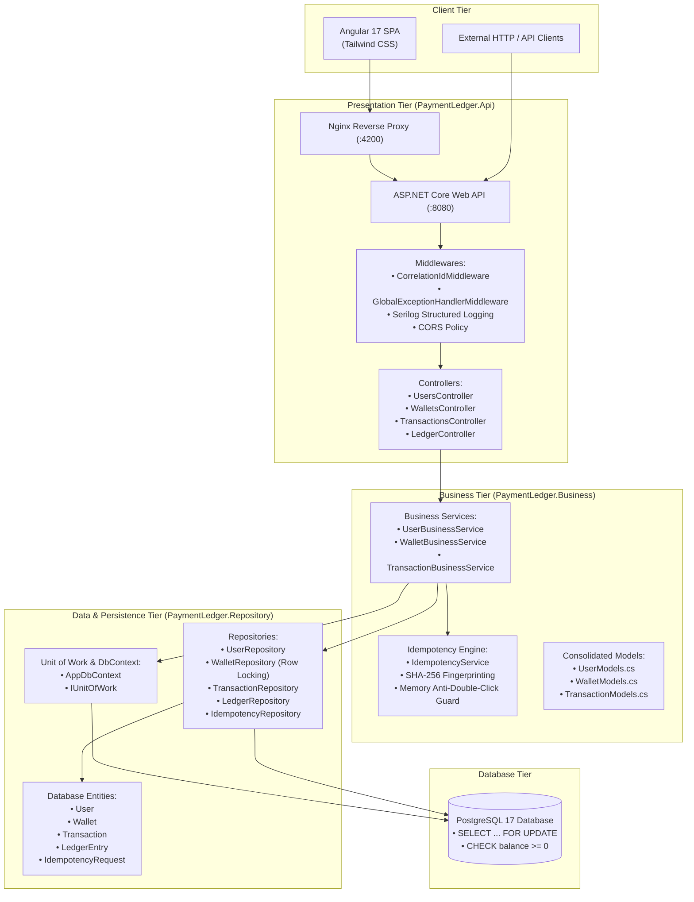
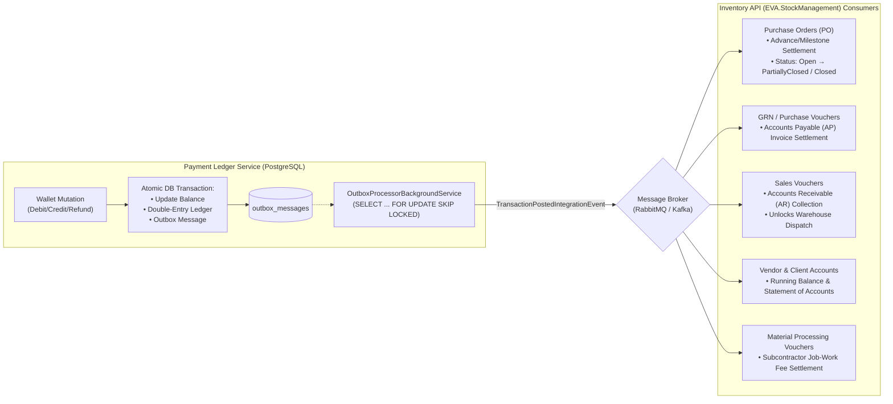

# Payment Ledger Service

Production-grade, idempotent digital wallet and double-entry financial ledger system built with **.NET 10**, **C# 13**, **PostgreSQL 17**, **Redis 7**, **Entity Framework Core 10**, and an **Angular 17** glassmorphic dashboard.

---

## 1. Table of Contents

- [System Architecture](#2-system-architecture)
- [Financial Ledger Principles & Invariants](#3-financial-ledger-principles--invariants)
- [Concurrency & Idempotency Guarantees](#4-concurrency--idempotency-guarantees)
- [Transactional Outbox & Event-Driven Ecosystem](#5-transactional-outbox--event-driven-ecosystem)
- [Security & Authentication](#6-security--authentication)
- [Project Structure](#7-project-structure)
- [Quick Start Guide](#8-quick-start-guide)
  - [Option A: Docker Compose (Full-Stack - Recommended)](#option-a-docker-compose-full-stack---recommended)
  - [Option B: Local .NET CLI Backend](#option-b-local-net-cli-backend)
  - [Option C: Angular Frontend Development Server](#option-c-angular-frontend-development-server)
- [API Endpoints Reference](#9-api-endpoints-reference)
- [Sample API Requests & Payloads](#10-sample-api-requests--payloads)
- [Postman Collection](#11-postman-collection)
- [Testing & Quality Gates](#12-testing--quality-gates)
  - [Unit Tests (216 tests)](#121-unit-tests)
  - [Architecture Tests (7 tests)](#122-architecture-boundary-tests)
  - [Integration & Concurrency Tests (9 tests)](#123-integration--concurrency-tests)
- [Database Migrations](#13-database-migrations)
- [Observability & Error Handling](#14-observability--error-handling)

---

## 2. System Architecture

The backend follows a streamlined, direct **3-tier architecture** with strict layer boundaries and zero MediatR/CQRS pipeline overhead:

```
Controller (Api) ──> Business (Logic & Validations) ──> Repository (Database Operations)
```



> Detailed architecture flows, sequence diagrams, and database entity relationships are documented in [docs/ARCHITECTURE.md](docs/ARCHITECTURE.md).

---

## 3. Financial Ledger Principles & Invariants

1. **Strict Double-Entry Bookkeeping**:
   Every balance-altering transaction generates at least two immutable `LedgerEntry` records (Debit and Credit) such that:
   $$\sum \text{Debits} == \sum \text{Credits} == \text{Transaction.Amount}$$
   - **Credit Flow**: System Treasury Debit, User Wallet Credit.
   - **Debit Flow**: User Wallet Debit, System Treasury Credit.
   - **Refund Flow**: System Treasury Debit, User Wallet Credit (linked via `ReferenceTransactionId`).

2. **Zero-Negative Balance Invariant**:
   - A digital wallet can **never** drop below `0.00`.
   - Guarded at the domain layer (`wallet.Debit(...)` throws `DomainException` if balance insufficient).
   - Enforced at the database engine level via PostgreSQL check constraint:
     ```sql
     CONSTRAINT ck_wallets_balance_non_negative CHECK (balance >= 0)
     ```

3. **Money Precision**:
   All monetary amounts are represented as `decimal` with precision `numeric(18,2)`. Amounts are rounded to 2 decimal places using `decimal.Round(amount, 2)`.

4. **Cryptographic Ledger Reconciliation**:
   The system provides on-demand verification endpoints (`/api/v1/ledger/verify`, `/wallets/{id}/verify`, `/transactions/{id}/verify`) ensuring zero divergence between wallet balances and sum of ledger credits minus debits.

---

## 4. Concurrency & Idempotency Guarantees

```mermaid
sequenceDiagram
    autonumber
    participant ReqA as Request A ($60 Debit)
    participant ReqB as Request B ($60 Debit)
    participant DB as PostgreSQL (Initial Balance = $100.00)

    Note over ReqA,ReqB: Both arrive concurrently at the exact same millisecond
    ReqA->>DB: BEGIN TX; SELECT * FROM wallets WHERE id = ... FOR UPDATE;
    Note over DB: Lock granted to Request A
    ReqB->>DB: BEGIN TX; SELECT * FROM wallets WHERE id = ... FOR UPDATE;
    Note over DB: Request B blocked waiting on Row Lock

    Note over ReqA,DB: Request A executes safely under lock
    ReqA->>DB: Balance ($100) >= $60 -> Update balance to $40
    ReqA->>DB: Insert Ledger Entries ($60 Debit, $60 Credit)
    ReqA->>DB: COMMIT TX;
    Note over DB: Lock released! Request A completes (HTTP 200 OK)

    Note over ReqB,DB: Lock now acquired by Request B
    DB-->>ReqB: Returns updated wallet row (Balance = $40.00)
    ReqB->>ReqB: Balance ($40.00) < $60.00 -> Fails Invariant Check!
    ReqB->>DB: ROLLBACK TX;
    Note over ReqB: Request B rejected with INSUFFICIENT_BALANCE (HTTP 409)
```

1. **Pessimistic Row-Level Locking (`SELECT ... FOR UPDATE`)**:
   - All balance-altering operations (debit, credit, refund) acquire an exclusive database row lock using `_walletRepository.GetByIdForUpdateAsync(walletId, ct)` inside an atomic database transaction (`_unitOfWork.BeginTransactionAsync(ct)`).
   - Under heavy concurrent contention against a low-balance wallet, debits serialize deterministically. Excess debits are rejected with HTTP 409 (`INSUFFICIENT_BALANCE`).

2. **Post-Lock Idempotency Verification**:
   - Because concurrent duplicate requests with the same `Idempotency-Key` may queue on the row lock while the initial request commits, services perform a **post-lock idempotency check** immediately after lock acquisition. If already processed by the predecessor, the transaction immediately rolls back and returns the cached `TransactionResponse`.

3. **SHA-256 Request Fingerprinting**:
   - Computes a SHA-256 digest of payload fields (`Amount`, `Currency`, `Description`, `Metadata`). Reusing an idempotency key with an altered payload triggers an immediate HTTP 409 (`IDEMPOTENCY_CONFLICT`).

4. **Distributed Anti-Double-Click & Fast-Path Caching (Redis)**:
   - Unkeyed rapid mutation requests trigger an atomic distributed Redis lock (`SETNX` with 3-second TTL), rejecting concurrent double-clicks across multi-node deployments with HTTP 429 (`DUPLICATE_REQUEST`).
   - Successful keyed mutations are cached in Redis (24-hour TTL) with payload SHA-256 validation to serve idempotency lookups in `<1ms` without querying PostgreSQL.

5. **Deterministic Business Keys**:
   - When clients supply an external `referenceId` (e.g. order ID), the service constructs `"{action}:{walletId}:{referenceId}"` to avoid duplicate charges even without UUID keys.

---

## 5. Transactional Outbox & Event-Driven Ecosystem

The system implements the **Transactional Outbox Pattern** to eliminate dual-write anomalies and power an asynchronous, distributed event-driven architecture with sibling services such as the **Inventory API (`EVA.StockManagement`)**.



1. **Transactional Outbox Guarantee**:
   - Domain events (`WalletCreatedEvent`, `TransactionPostedEvent`, `WalletStatusChangedEvent`) are staged via `IEventPublisher` within the active `IUnitOfWork`.
   - Saved and committed atomically alongside wallet balance changes, idempotency records, and ledger entries in a single PostgreSQL transaction.
2. **PostgreSQL Concurrency Safety (`SELECT ... FOR UPDATE SKIP LOCKED`)**:
   - `OutboxProcessorBackgroundService` polls the database every 5 seconds.
   - Uses `SELECT ... FOR UPDATE SKIP LOCKED` inside a transaction: multiple concurrent worker replicas process separate batches in parallel without waiting or locking out sibling nodes.
3. **Multi-Consumer Ecosystem (Inventory API)**:
   - Publishes `TransactionPostedIntegrationEvent` carrying `ReferenceId` (`PO-xxx`, `PV-xxx`, `SV-xxx`), `Amount`, and `Type`.
   - Designed for downstream consumption across multiple business domains in `EVA.StockManagement`:
     - **Purchase Orders (PO)**: Reconciles supplier advances and closes purchase commitments upon payment.
     - **Goods Received Notes (GRN / Purchase Vouchers)**: Accounts Payable (AP) settlement upon physical material receipt.
     - **Sales Vouchers**: Accounts Receivable (AR) customer collections; triggers stock reservation and delivery gate-pass release.
     - **Vendor & Client Accounts**: Continuous ledger statement reconciliation and credit limit tracking.
     - **Material Processing Vouchers**: Automatic subcontractor fee disbursements.

---

## 6. Security & Authentication

The system implements a robust, stateless JWT (JSON Web Token) authentication layer to secure endpoints and enforce resource ownership.

1. **JWT Bearer Authentication**:
   - Cryptographically signed using HMAC-SHA256.
   - Includes standard claims (`sub` for UserId, `email`, `role`) and specialized `scope` claims.
2. **Scope-Based Authorization (Policies)**:
   - `Policies.ReadWallet`: Requires `read:wallet` scope or `Admin` role. Secures read-only views of wallets and transactions.
   - `Policies.WriteWallet`: Requires `write:wallet` scope or `Admin` role. Secures mutating actions (Credits, Debits, Blocking).
   - `Policies.AdminLedger`: Requires `admin:ledger` scope or `Admin` role. Secures high-privilege endpoints (Reconciliation verifications, user administration, transaction refunds).
3. **Strict Wallet Ownership Enforcement**:
   - Implemented in the Business layer (`WalletBusinessService`), ensuring users cannot access or mutate wallets they do not own unless they possess `Admin` privileges. Violations throw an automatic `Forbidden` exception.
4. **Token Generation Endpoint**:
   - `POST /api/v1/auth/token` allows clients/B2B services to generate signed access tokens with custom scopes to interface securely with the API.

---

## 7. Project Structure

```
PaymentLedgerService/
├── docs/
│   ├── ARCHITECTURE.md                 # Complete Mermaid diagrams, workflows, and schema
│   └── API_SAMPLES.md                  # Comprehensive cURL requests and JSON responses
│
├── src/
│   ├── PaymentLedger.Api/              # Presentation Tier
│   │   ├── Controllers/               # UsersController, WalletsController, TransactionsController, LedgerController
│   │   ├── BackgroundServices/        # OutboxProcessorBackgroundService (SKIP LOCKED batch worker)
│   │   ├── Middleware/                # CorrelationIdMiddleware, GlobalExceptionHandlerMiddleware
│   │   ├── Filters/                   # ApiResponseCorrelationFilter
│   │   ├── Extensions/                # ServiceCollectionExtensions (DI, CORS, Swagger)
│   │   └── Program.cs                 # App bootstrap, Serilog config, pipeline configuration
│   │
│   ├── PaymentLedger.Business/         # Business & Financial Orchestration Tier
│   │   ├── Services/                  # UserBusinessService, WalletBusinessService, TransactionBusinessService, OutboxDispatcherService
│   │   ├── Events/                    # DomainEvents (WalletCreated, TransactionPosted), IEventPublisher, IIntegrationEventPublisher
│   │   ├── Models/                    # Consolidated Per-API Models (UserModels.cs, WalletModels.cs, TransactionModels.cs)
│   │   ├── Common/                    # IdempotencyService, SystemDateTimeProvider
│   │   ├── Exceptions/                # ValidationException, ExceptionToResponseMapper
│   │   └── DependencyInjection.cs     # AddBusiness() DI extension
│   │
│   ├── PaymentLedger.Repository/       # Data Access & Persistence Tier
│   │   ├── Entities/                  # User, Wallet, Transaction, LedgerEntry, IdempotencyRequest, OutboxMessage
│   │   ├── Enums/                     # WalletStatus, TransactionType, TransactionStatus, LedgerEntryType, UserStatus
│   │   ├── ValueObjects/              # Money
│   │   ├── Persistence/               # AppDbContext, Configurations/ (EF Core fluent mappings), Migrations/
│   │   ├── Repositories/              # UserRepository, WalletRepository, TransactionRepository, LedgerRepository, IdempotencyRepository, OutboxRepository
│   │   ├── Abstractions/              # IUnitOfWork, IAppDbContext, repository interfaces, IDateTimeProvider
│   │   ├── Seeding/                   # TreasuryWalletSeeder (seeds Treasury user & multi-currency wallets)
│   │   └── DependencyInjection.cs     # AddRepository() DI extension
│   │
│   └── PaymentLedger.Shared/           # Cross-Cutting Shared Contracts
│       ├── Responses/                 # ApiResponse<T>, ErrorResponse, PagedResponse<T>, IApiResponse
│       ├── Constants/                 # ErrorCodes
│       ├── Context/                   # CorrelationContext, ICorrelationIdProvider
│       ├── Options/                   # JwtOptions, OutboxOptions, KafkaOptions
│       └── Events/                    # TransactionPostedIntegrationEvent
│
├── tests/
│   ├── PaymentLedger.UnitTests/         # 216 tests: Invariants, business edge cases, concurrency, Redis resilience, Outbox pattern & Kafka publisher
│   ├── PaymentLedger.ArchitectureTests/ # 7 tests: NetArchTest enforcing strict layer boundaries
│   └── PaymentLedger.IntegrationTests/  # 9 tests: Real PostgreSQL Testcontainers integration & concurrency tests
│
├── PaymentLedger.UI/                   # Angular 17.3 frontend with Tailwind CSS
│   ├── proxy.conf.json                # Dev proxy routing /api requests to backend
│   └── src/app/
│       ├── core/                      # Interceptors, models, services (api.service, user.service, wallet.service)
│       ├── features/                  # dashboard, users, wallets (wallet-details, burst/concurrency tester)
│       └── shared/                    # Layout and reusable UI components
│
└── PaymentLedger.postman_collection.json # Full Postman v2.1.0 collection with test scripts & variables
```

---

## 8. Quick Start Guide

### Option A: Docker Compose (Full-Stack - Recommended)

Runs PostgreSQL 17, Redis 7, Apache Kafka (KRaft), Kafka UI, Web API (port 8080), and Angular UI (port 4200):

```powershell
# Build and launch all services in background
docker compose up -d --build

# View container logs
docker compose logs -f

# Stop all services
docker compose down

# Stop and wipe database volume
docker compose down -v
```

Endpoints:
- **Angular UI**: `http://localhost:4200`
- **Web API**: `http://localhost:8080`
- **Swagger UI**: `http://localhost:8080/swagger`
- **Health Check**: `http://localhost:8080/health`
- **Kafka Web UI**: `http://localhost:8085`
- **Kafka Broker (Host PLAINTEXT)**: `localhost:9092`
- **RabbitMQ (Optional - via `--profile rabbitmq`)**: AMQP `localhost:5672`, Management UI `http://localhost:15672`

---

### Option B: Local .NET CLI Backend

Requires a local PostgreSQL instance (configure connection in `src/PaymentLedger.Api/appsettings.Development.json`):

```powershell
# Restore and run API
dotnet run --project src/PaymentLedger.Api
```

Endpoints:
- **HTTP**: `http://localhost:5275`
- **HTTPS**: `https://localhost:7155`
- **Swagger UI**: `http://localhost:5275/swagger`
- **Health Check**: `http://localhost:5275/health`

---

### Option C: Angular Frontend Development Server

Inside `PaymentLedger.UI/`:

```powershell
# Install npm dependencies
npm install

# Start development server with API proxying (http://localhost:4200)
npm start

# Build production bundle
npm run build
```

---

## 9. API Endpoints Reference

### Authentication (/api/v1/auth)
- POST /api/v1/auth/token: Issue signed JWT access tokens specifying roles and scopes.

### User Management (`/api/v1/users`)
- `POST /api/v1/users`: Create user with unique email validation.
- `GET /api/v1/users`: Paginated user listing with search query support.
- `GET /api/v1/users/{id}`: Retrieve user details by ID.
- `PUT /api/v1/users/{id}`: Update user name and email.
- `DELETE /api/v1/users/{id}`: Delete user (blocks deletion if active wallets exist).

### Wallet Lifecycle (`/api/v1/wallets`)
- `POST /api/v1/wallets`: Create currency-specific wallet for active user.
- `GET /api/v1/wallets/{id}`: Retrieve wallet metadata and status.
- `GET /api/v1/wallets/{id}/balance`: Query real-time wallet balance.
- `GET /api/v1/wallets?userId={userId}`: Query all wallets belonging to a user.
- `PATCH /api/v1/wallets/{id}/block`: Block wallet from financial transactions.
- `PATCH /api/v1/wallets/{id}/unblock`: Unblock wallet.
- `PATCH /api/v1/wallets/{id}/close`: Close empty wallet (enforces zero-balance invariant).

### Financial Mutations (`/api/v1/wallets`)
- `POST /api/v1/wallets/{id}/credit`: Deposit funds from System Treasury with balanced double-entry ledger entries.
- `POST /api/v1/wallets/{id}/debit`: Debit funds to System Treasury with pessimistic row locking (`SELECT ... FOR UPDATE`).
- `GET /api/v1/wallets/{id}/transactions`: Server-side paginated transaction history with type/status/date filtering.

### Refunds & Ledger Audits (`/api/v1/transactions`, `/api/v1/ledger`)
- `POST /api/v1/transactions/{id}/refund`: Process full or partial refund for a debit transaction.
- `GET /api/v1/transactions/{id}`: Detailed transaction lookup with child double-entry ledger entries.
- `GET /api/v1/transactions/{id}/verify`: Per-transaction double-entry balance verification.
- `GET /api/v1/wallets/{id}/verify`: Wallet balance reconciliation against ledger entries.
- `POST /api/v1/ledger/verify` / `GET /api/v1/ledger/verify`: System-wide cryptographic consistency audit.

---

## 10. Sample API Requests & Payloads

### Credit Wallet (Deposit from Treasury)
```bash
curl -X POST "http://localhost:8080/api/v1/wallets/{walletId}/credit" \
  -H "Content-Type: application/json" \
  -H "Idempotency-Key: credit-usr-1001-topup" \
  -d '{
    "amount": 200.00,
    "currency": "USD",
    "description": "Initial account deposit",
    "metadata": "{\"channel\":\"online_banking\"}"
  }'
```

**Response (`200 OK`):**
```json
{
  "success": true,
  "message": "Wallet credited successfully.",
  "data": {
    "transactionId": "b47c9e01-2a1d-488f-9a02-23f461879c7b",
    "transactionCode": "TXN-CR-20260927-B47C9E01",
    "type": "Credit",
    "status": "Posted",
    "amount": 200.00,
    "currency": "USD",
    "balanceAfterTransaction": 200.00,
    "createdAt": "2026-09-27T12:00:00.000Z"
  },
  "correlationId": "corr-uuid"
}
```

### Debit Wallet (Pessimistic Lock & Idempotent)
```bash
curl -X POST "http://localhost:8080/api/v1/wallets/{walletId}/debit" \
  -H "Content-Type: application/json" \
  -H "Idempotency-Key: debit-order-5501" \
  -d '{
    "amount": 50.00,
    "currency": "USD",
    "referenceId": "order-5501",
    "description": "Purchase transaction"
  }'
```

**Response (`200 OK`):**
```json
{
  "success": true,
  "message": "Wallet debited successfully.",
  "data": {
    "transactionId": "d821fa91-66c2-4bbf-a29e-1903eef580d2",
    "transactionCode": "TXN-DB-20260927-D821FA91",
    "type": "Debit",
    "status": "Posted",
    "amount": 50.00,
    "currency": "USD",
    "balanceAfterTransaction": 150.00,
    "createdAt": "2026-09-27T12:05:00.000Z"
  },
  "correlationId": "corr-uuid"
}
```

> Additional curl requests, error responses (400, 404, 409, 429, 500), and refund flows are available in [docs/API_SAMPLES.md](docs/API_SAMPLES.md).

---

## 11. Postman Collection

A complete, production-ready Postman collection is located at the root of the repository:

**[`PaymentLedger.postman_collection.json`](PaymentLedger.postman_collection.json)**

### Features:
- Fully compliant with Postman Collection v2.1.0 format.
- Pre-configured environment variables (`baseUrl`, `userId`, `walletId`, `transactionId`).
- Automated pre-request scripts generating dynamic `Idempotency-Key` and `X-Correlation-ID` headers.
- Automated test assertion scripts verifying HTTP status codes, response envelopes, and saving generated IDs for chained workflow execution.
- 5 organized folders:
  1. `1. Health & Diagnostics`
  2. `2. Users`
  3. `3. Wallets`
  4. `4. Financial Transactions`
  5. `5. Refunds & Reconciliations`

---

## 12. Testing & Quality Gates

The test suite enforces full verification across 3 dedicated test projects:

```powershell
# Run the entire solution test suite
dotnet test PaymentLedgerService.sln
```

### 12.1 Unit Tests
**216 tests** (fast, in-memory execution):
- Domain model invariants, money precision, wallet status state machine, and ledger double-entry balancing.
- Business service orchestration (`UserBusinessService`, `WalletBusinessService`, `TransactionBusinessService`).
- Transactional outbox dispatching and Apache Kafka integration event publishing (`KafkaIntegrationEventPublisher`).
- Distributed idempotency engine verification: SHA-256 fingerprinting, replay of cached transactions, post-lock recheck verification, Redis fail-safe fault tolerance, and multi-threaded anti-double-click guard testing.
- Refund lifecycle, over-refund guardrails, and transaction reference linking.
- Controller endpoints and exception-to-response mapping.

```powershell
dotnet test tests/PaymentLedger.UnitTests/PaymentLedger.UnitTests.csproj
```

### 12.2 Architecture Boundary Tests
**7 tests** (NetArchTest rules enforcing clean 3-tier layering):
- `Api` only references `Business` and `Shared` (no direct `Repository` references).
- `Business` only references `Repository` and `Shared` (no `Api` references).
- `Repository` only references `Shared` (no `Business` or `Api` references).
- Controllers never reference Entity Framework Core or database repositories directly.
- Middlewares reside strictly in `PaymentLedger.Api.Middleware`.

```powershell
dotnet test tests/PaymentLedger.ArchitectureTests/PaymentLedger.ArchitectureTests.csproj
```

### 12.3 Integration & Concurrency Tests
**9 tests** (Real PostgreSQL container execution via Testcontainers):
- True database transaction concurrency: 10 concurrent HTTP debits against a low-balance wallet verifying `SELECT ... FOR UPDATE` row locking prevents negative balances.
- Concurrent deduplication: 5 parallel requests with identical `Idempotency-Key` execute exactly once without double-debiting.
- Database schema migration, idempotent treasury seeding, and health checks.

```powershell
dotnet test tests/PaymentLedger.IntegrationTests/PaymentLedger.IntegrationTests.csproj
```

---

## 13. Database Migrations

Migrations and entity configurations reside inside `PaymentLedger.Repository`. Always specify both `--project` and `--startup-project`:

```powershell
# Add a new migration
dotnet ef migrations add <MigrationName> `
  --project src/PaymentLedger.Repository `
  --startup-project src/PaymentLedger.Api `
  --output-dir Persistence/Migrations

# Apply pending migrations to the configured database
dotnet ef database update `
  --project src/PaymentLedger.Repository `
  --startup-project src/PaymentLedger.Api

# Generate idempotent SQL script of migrations
dotnet ef migrations script `
  --project src/PaymentLedger.Repository `
  --startup-project src/PaymentLedger.Api `
  --output migrations.sql
```

> [!NOTE]
> On startup, `Program.cs` automatically executes `dbContext.Database.MigrateAsync()` and runs `TreasuryWalletSeeder.SeedAsync()` to ensure migrations and system treasury accounts are created idempotently.

---

## 14. Observability & Error Handling

All client and server errors are trapped by `GlobalExceptionHandlerMiddleware` and converted into standardized `ErrorResponse` envelopes without stack trace leakage:

| Error Code | HTTP Status | Description |
|---|---|---|
| `UNAUTHORIZED` / `INVALID_TOKEN` | 401 Unauthorized | Missing, invalid, or expired JWT token |
| `FORBIDDEN` | 403 Forbidden | User lacks required scope or does not own the requested wallet |
| `VALIDATION_FAILED` | 400 Bad Request | Request model validation failed (missing or invalid fields) |
| `CURRENCY_MISMATCH` | 400 Bad Request | Target wallet currency does not match transaction currency |
| `WALLET_NOT_ACTIVE` | 400 Bad Request | Target or treasury wallet is not in Active status |
| `TRANSACTION_NOT_REFUNDABLE` | 400 Bad Request | Transaction cannot be refunded (not a debit, or already refunded) |
| `REFUND_AMOUNT_EXCEEDED` | 400 Bad Request | Requested refund amount exceeds remaining refundable amount |
| `USER_NOT_FOUND` | 404 Not Found | Specified user ID does not exist |
| `WALLET_NOT_FOUND` | 404 Not Found | Specified wallet ID does not exist |
| `TRANSACTION_NOT_FOUND` | 404 Not Found | Specified transaction ID does not exist |
| `INSUFFICIENT_BALANCE` | 409 Conflict | Target wallet lacks sufficient funds for debit operation |
| `IDEMPOTENCY_CONFLICT` | 409 Conflict | Idempotency key reused with an altered request payload |
| `CONCURRENCY_CONFLICT` | 409 Conflict | Mutation with this idempotency key is currently processing |
| `USER_ALREADY_EXISTS` | 409 Conflict | User with this email already exists |
| `DUPLICATE_REQUEST` | 429 Too Many Requests | Unkeyed request throttled by anti-double-click guard |
| `INTERNAL_SERVER_ERROR` | 500 Internal Server Error | Unhandled server exception (stack trace redacted) |


