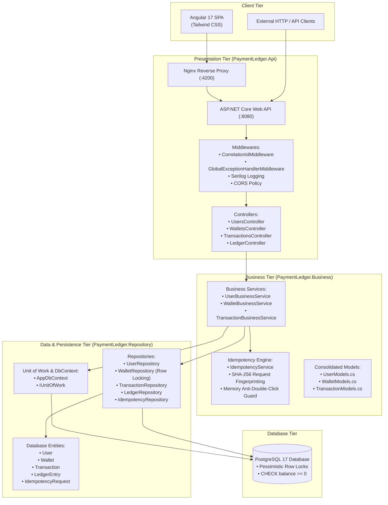
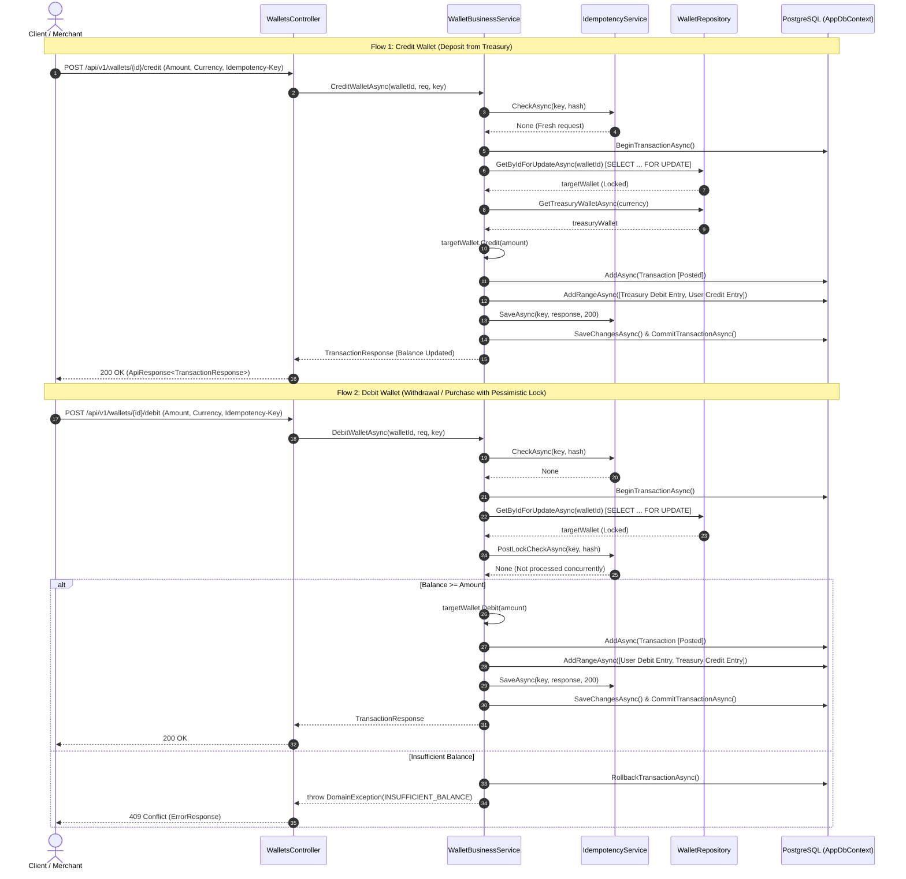
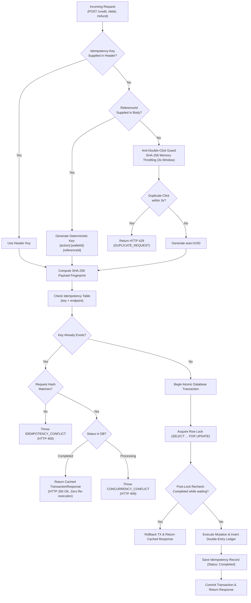
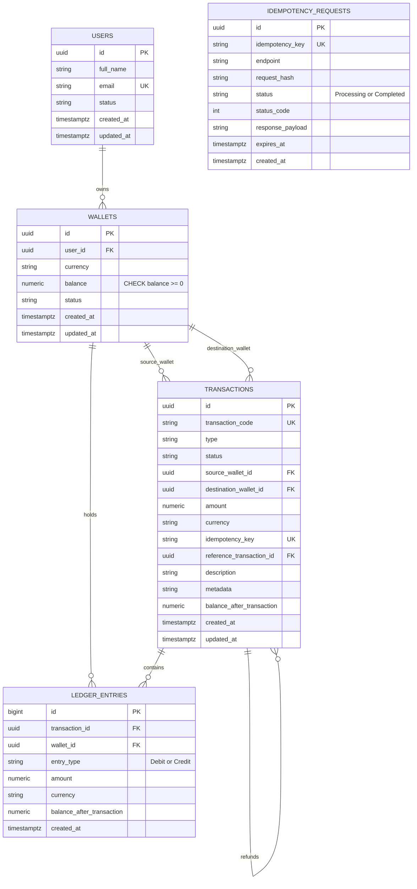

# Payment Ledger Service — Architecture & Design

This document details the architectural design, financial ledger principles, concurrency controls, and idempotency guarantees of the **Payment Ledger Service**.

---

## 1. System Architecture Overview

The system follows a streamlined, direct **3-tier architecture** with zero CQRS/MediatR indirection:



---

## 2. Double-Entry Ledger Bookkeeping Architecture

Every financial movement creates at least two immutable, balanced `LedgerEntry` records such that:

$$\sum \text{Debits} = \sum \text{Credits} = \text{Transaction.Amount}$$

All money entries are tracked strictly against System Treasury accounts.



---

## 3. Concurrency Protection & Pessimistic Row Locking

When multiple parallel requests target the same wallet simultaneously (e.g. rapid card swipes, race condition exploits):

```mermaid
sequenceDiagram
    autonumber
    participant ReqA as Request A ($60 Debit)
    participant ReqB as Request B ($60 Debit)
    participant DB as PostgreSQL (Initial Balance = $100.00)

    Note over ReqA,ReqB: Both requests arrive at the exact same millisecond
    ReqA->>DB: BEGIN TX; SELECT * FROM wallets WHERE id = ... FOR UPDATE;
    Note over DB: Lock granted to Request A
    ReqB->>DB: BEGIN TX; SELECT * FROM wallets WHERE id = ... FOR UPDATE;
    Note over DB: Request B blocked waiting on Row Lock

    Note over ReqA,DB: Request A executes under lock
    ReqA->>DB: Balance ($100) >= $60 -> Update balance to $40
    ReqA->>DB: Insert Ledger Entries ($60 Debit, $60 Credit)
    ReqA->>DB: COMMIT TX;
    Note over DB: Lock released! Request A completes (HTTP 200 OK)

    Note over ReqB,DB: Lock now acquired by Request B
    DB-->>ReqB: Returns updated wallet row (Balance = $40.00)
    ReqB->>ReqB: Balance ($40.00) < $60.00 -> Fails Invariant Check!
    ReqB->>DB: ROLLBACK TX;
    Note over ReqB: Request B rejected with INSUFFICIENT_BALANCE (HTTP 409)
```

### Invariants Enforced
1. **Zero-Negative Balance**: `wallet.Balance >= 0.00` guaranteed by both domain validation and database check constraint:
   ```sql
   CONSTRAINT ck_wallets_balance_non_negative CHECK (balance >= 0)
   ```
2. **Strict Serialization**: All balance mutations are serialized via `GetByIdForUpdateAsync(walletId)`.
3. **Double-Entry Equality**: `sum(debits) - sum(credits) == 0` verified continuously.

---

## 4. Idempotency Lifecycle & Tamper Detection

The service features an automated, centralized idempotency engine:



---

## 5. Database Schema & Entity Relationships


