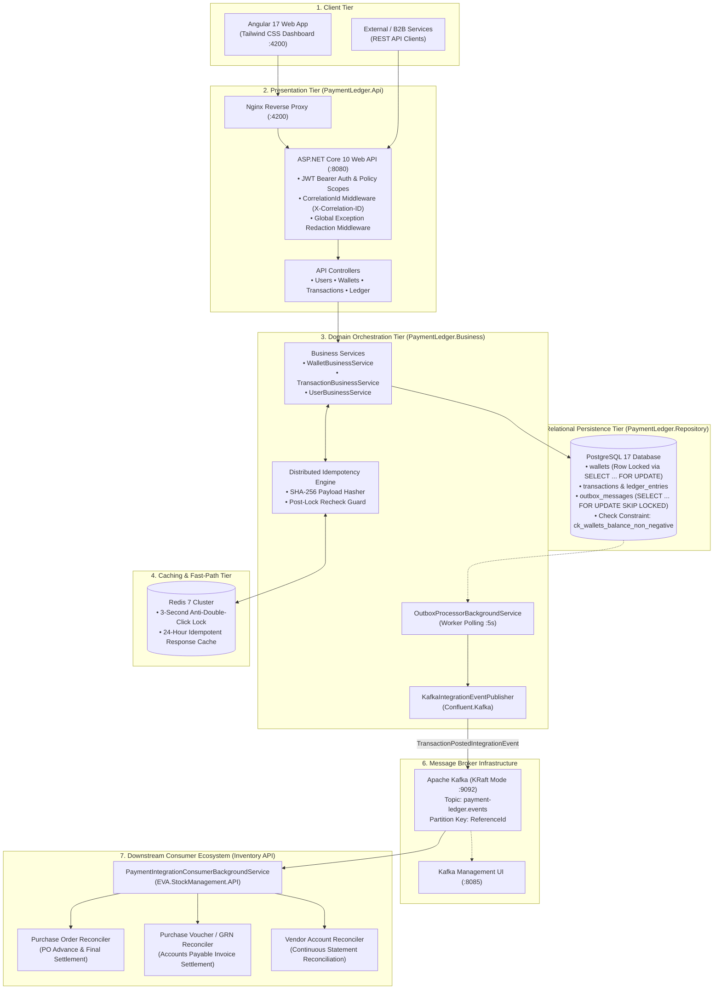
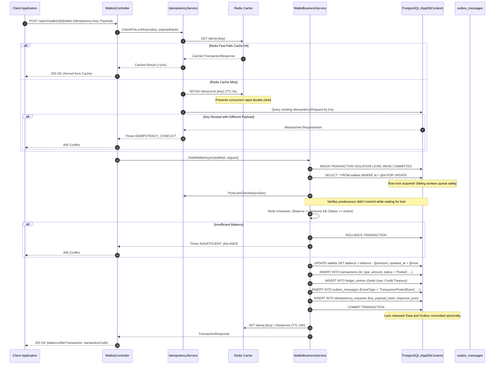
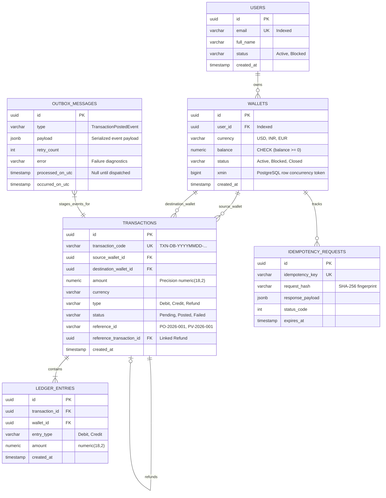
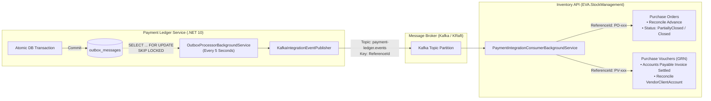
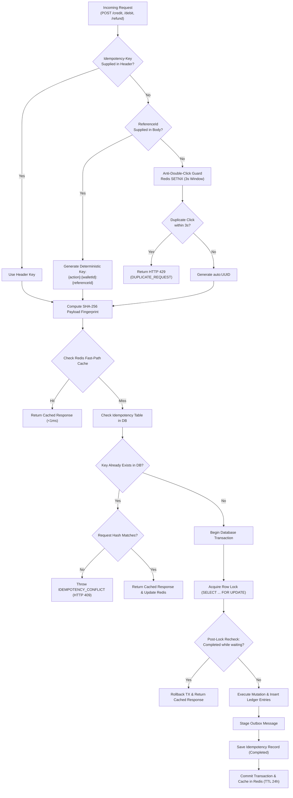

# 🏗️ Payment Ledger Service — Architecture & Design Blueprint

This document contains the complete High-Level Design (HLD) and Low-Level Design (LLD) specifications, concurrency controls, domain entity models, and event-driven integration flows for the **Payment Ledger Service**.

---

## 📑 Table of Contents

- [1. High-Level Design (HLD): Macro Topology](#1-high-level-design-hld-macro-topology)
- [2. Low-Level Design (LLD): Financial Mutation Pipeline](#2-low-level-design-lld-financial-mutation-pipeline)
- [3. Low-Level Design (LLD): Database Schema & Entity Relationships](#3-low-level-design-lld-database-schema--entity-relationships)
- [4. Transactional Outbox & Event-Driven Streaming](#4-transactional-outbox--event-driven-streaming)
- [5. Concurrency Protection & Pessimistic Row Locking](#5-concurrency-protection--pessimistic-row-locking)
- [6. Multi-Tier Idempotency Lifecycle & Tamper Detection](#6-multi-tier-idempotency-lifecycle--tamper-detection)

---

## 1. High-Level Design (HLD): Macro Topology

The macro-system topology spans user-facing clients, an API presentation gateway, transactional core domain, distributed caching, PostgreSQL relational storage, and Kafka-driven integration with downstream ERP microservices:



---

## 2. Low-Level Design (LLD): Financial Mutation Pipeline

The sequence below illustrates the end-to-end execution of a balance mutation (`Debit`), detailing the multi-stage concurrency controls, row locking, double-entry ledger insertion, outbox staging, and cache updates:



---

## 3. Low-Level Design (LLD): Database Schema & Entity Relationships

The relational schema strictly enforces double-entry bookkeeping, transactional outbox storage, and cryptographic idempotency tracking:



---

## 4. Transactional Outbox & Event-Driven Streaming



### Outbox Pattern Guarantees
1. **Zero Dual-Write Anomalies**: Events are committed to `outbox_messages` in the same database transaction as ledger modifications.
2. **Lock-Free Concurrency (`SKIP LOCKED`)**: Worker nodes concurrently poll unprocessed records without contention:
   ```sql
   SELECT * FROM outbox_messages
   WHERE processed_on_utc IS NULL AND retry_count < @maxRetries
   ORDER BY occurred_on_utc ASC
   LIMIT @batchSize
   FOR UPDATE SKIP LOCKED;
   ```
3. **Partition-Keyed Ordering**: All events carry `ReferenceId` as the Kafka message key, ensuring strict sequential processing of related transactions on the same partition.

---

## 5. Concurrency Protection & Pessimistic Row Locking

When multiple concurrent requests target the same wallet (e.g. parallel debits, race condition attempts):

```mermaid
sequenceDiagram
    autonumber
    participant ReqA as Request A ($60 Debit)
    participant ReqB as Request B ($60 Debit)
    participant DB as PostgreSQL (Initial Balance = $100.00)

    Note over ReqA,ReqB: Both arrive concurrently at the exact same millisecond
    ReqA->>DB: BEGIN TX; SELECT * FROM wallets WHERE id = ... FOR UPDATE;
    Note over DB: Lock granted to Request A
    ReqB->>DB: BEGIN TX; SELECT * FROM wallets WHERE id = ... FOR UPDATE;
    Note over DB: Request B blocked waiting on Row Lock

    Note over ReqA,DB: Request A executes safely under lock
    ReqA->>DB: Balance ($100) >= $60 -> Update balance to $40
    ReqA->>DB: Insert Ledger Entries ($60 Debit, $60 Credit)
    ReqA->>DB: COMMIT TX;
    Note over DB: Lock released! Request A completes (HTTP 200 OK)

    Note over ReqB,DB: Lock now acquired by Request B
    DB-->>ReqB: Returns updated wallet row (Balance = $40.00)
    ReqB->>ReqB: Balance ($40.00) < $60.00 -> Fails Invariant Check!
    ReqB->>DB: ROLLBACK TX;
    Note over ReqB: Request B rejected with INSUFFICIENT_BALANCE (HTTP 409)
```

---

## 6. Multi-Tier Idempotency Lifecycle & Tamper Detection


